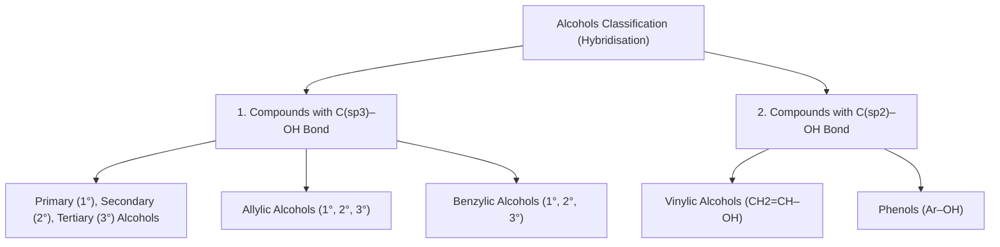

# 🧪 NCERT Class 12 Chemistry (Part II) — Unit 7: Alcohols, Phenols and Ethers
## Comprehensive Study Notes & Fill-in-the-Blanks Question Bank (Pages 1 & 2 / Text Pages 194–195)
### 📘 Author: Er. Manoj Kumar | Nextsem Academy

---

# 📌 1. Comprehensive Notes from Pages 1 & 2

### 🔬 1.1 Introduction & Everyday Applications
1. **Functional Importance in Daily Life:**
   - **Alcohols, Phenols, and Ethers** form the core chemical foundations for:
     - **Detergents** $\rightarrow$ Derived from long-chain alcohols.
     - **Antiseptics & Disinfectants** $\rightarrow$ Derived from phenols (e.g. Dettol / chloroxylenol, Lysol).
     - **Fragrances & Perfumes** $\rightarrow$ Derived from ethers.
2. **Ubiquitous –OH Compounds in Daily Life:**
   - **Ethanol ($C_2H_5OH$):** Chief component of ordinary spirit used for polishing wooden furniture.
   - **Sugar (Sucrose/Glucose):** Polyhydroxy compounds essential for metabolic energy.
   - **Cotton Fabrics (Cellulose):** Polyhydroxy carbohydrate polymer.
   - **Paper:** Made of cellulose fibers containing numerous –OH groups (books, newspapers, currency notes, certificates).

---

### 🔬 1.2 Fundamental Definitions & Structures

| Class | Definition | General Formula | Example |
| :--- | :--- | :---: | :--- |
| **Alcohol** | Formed when a hydrogen atom of an **aliphatic hydrocarbon** is replaced by a hydroxyl (–OH) group. | $R–OH$ | Methanol ($CH_3OH$), Ethanol ($C_2H_5OH$) |
| **Phenol** | Formed when a hydrogen atom of an **aromatic hydrocarbon** is replaced by a hydroxyl (–OH) group directly attached to the benzene ring. | $Ar–OH$ | Phenol / Carbolic Acid ($C_6H_5OH$) |
| **Ether** | Formed by substituting a hydrogen atom in a hydrocarbon by an **alkoxy ($R–O–$)** or **aryloxy ($Ar–O–$)** group, or by substituting the –H of an alcohol/phenol by an alkyl/aryl group. | $R–O–R'$ / $R–O–Ar$ / $Ar–O–Ar'$ | Dimethyl ether ($CH_3–O–CH_3$), Anisole ($C_6H_5–O–CH_3$) |

---

### 🔬 1.3 Classification of Alcohols & Phenols

#### A. Based on Number of Hydroxyl (–OH) Groups:
1. **Monohydric:** Contains **one** –OH group (e.g. $CH_3CH_2OH$, Phenol $C_6H_5OH$).
2. **Dihydric:** Contains **two** –OH groups (e.g. Ethane-1,2-diol / Glycol; Benzene-1,2-diol / Catechol).
3. **Trihydric:** Contains **three** –OH groups (e.g. Propane-1,2,3-triol / Glycerol; Benzene-1,2,3-triol / Pyrogallol).
4. **Polyhydric:** Contains **four or more** –OH groups (e.g. Sorbitol, Glucose).

---

#### B. Classification Based on Hybridisation of Carbon Attached to –OH:

#### 1. Compounds containing $C_{sp^3}–OH$ Bond:
- **(a) Primary ($1^\circ$), Secondary ($2^\circ$), and Tertiary ($3^\circ$) Alkyl Alcohols:**
  - **$1^\circ$ (Primary):** –OH is attached to a primary carbon atom (bonded to 0 or 1 other carbon): $R–CH_2–OH$ (e.g. Ethanol $CH_3CH_2OH$).
  - **$2^\circ$ (Secondary):** –OH is attached to a secondary carbon atom (bonded to 2 other carbons): $R_2CH–OH$ (e.g. Propan-2-ol $CH_3–CH(OH)–CH_3$).
  - **$3^\circ$ (Tertiary):** –OH is attached to a tertiary carbon atom (bonded to 3 other carbons): $R_3C–OH$ (e.g. 2-Methylpropan-2-ol $(CH_3)_3C–OH$).

- **(b) Allylic Alcohols:**
  - The –OH group is attached to an **$sp^3$-hybridised carbon adjacent to a carbon-carbon double bond** ($–C=C–C(sp^3)–OH$).
  - **$1^\circ$ Allylic:** $CH_2=CH–CH_2OH$ (Prop-2-en-1-ol)
  - **$2^\circ$ Allylic:** $CH_2=CH–CH(OH)–CH_3$ (But-3-en-2-ol)
  - **$3^\circ$ Allylic:** $CH_2=CH–C(OH)(CH_3)_2$ (2-Methylbut-3-en-2-ol)

- **(c) Benzylic Alcohols:**
  - The –OH group is attached to an **$sp^3$-hybridised carbon atom next to an aromatic ring** ($Ar–C(sp^3)–OH$).
  - **$1^\circ$ Benzylic:** $C_6H_5–CH_2OH$ (Benzyl alcohol / Phenylmethanol)
  - **$2^\circ$ Benzylic:** $C_6H_5–CH(OH)–CH_3$ (1-Phenylethanol)
  - **$3^\circ$ Benzylic:** $C_6H_5–C(OH)(CH_3)_2$ (2-Phenylpropan-2-ol)

---

#### 2. Compounds containing $C_{sp^2}–OH$ Bond:
- **(a) Vinylic Alcohols:**
  - The –OH group is bonded directly to an **$sp^2$-hybridised vinylic carbon atom of a double bond** ($–C=C–OH$).
  - *Example:* Vinyl alcohol ($CH_2=CH–OH$).
- **(b) Phenols:**
  - The –OH group is bonded directly to an **$sp^2$-hybridised aromatic ring carbon** ($C_6H_5–OH$).

---

# 📝 2. 20 Master Fill-in-the-Blanks Questions (With Answers & Explanations)

1. Alcohols, phenols and ethers are the basic organic compounds used for the formation of **`detergents`**, **`antiseptics`**, and **`fragrances`**, respectively.
   - *Explanation: Page 1 line 1 explicitly states this fundamental industrial triplet.*

2. Alcohols are formed when a hydrogen atom in an **`aliphatic`** hydrocarbon is replaced by a hydroxyl (–OH) group.
   - *Explanation: Replacement of H in alkanes/alkenes/alkynes yields aliphatic alcohols.*

3. Phenols are formed when a hydrogen atom in an **`aromatic`** hydrocarbon is replaced by a hydroxyl (–OH) group directly attached to the ring.
   - *Explanation: Phenol ($C_6H_5OH$) contains –OH directly on the benzene ring.*

4. Ordinary spirit used for polishing wooden furniture is chiefly **`ethanol`** ($C_2H_5OH$).
   - *Explanation: Commercial spirit contains denatured ethanol as its primary solvent component.*

5. Cotton fabrics, paper, and table sugar are all made up of chemical compounds containing **`hydroxyl`** (–OH) functional groups.
   - *Explanation: Cellulose and sucrose are polyhydroxy carbohydrate molecules.*

6. Substitution of a hydrogen atom in a hydrocarbon by an alkoxy ($R–O–$) or aryloxy ($Ar–O–$) group yields **`ethers`**.
   - *Explanation: General formula of ethers is $R–O–R'$ or $Ar–O–R$.*

7. Dimethyl ether ($CH_3OCH_3$) is a classic example of an **`ether`**.
   - *Explanation: Oxygen atom is bonded to two alkyl (methyl) groups.*

8. Ethers can also be visualised as compounds formed by substituting the hydrogen atom of the hydroxyl group of an alcohol or phenol by an **`alkyl`** or **`aryl`** group.
   - *Explanation: $R–O–H \rightarrow R–O–R'$ or $Ar–O–H \rightarrow Ar–O–R'$.*

9. Alcohols containing only one –OH group per molecule are classified as **`monohydric`** alcohols.
   - *Explanation: 'Mono' indicates single hydroxyl substitution (e.g. $CH_3OH$).*

10. Ethane-1,2-diol (glycol) contains two –OH groups and is classified as a **`dihydric`** alcohol.
    - *Explanation: Dihydric alcohols contain two hydroxyl groups attached to different carbons.*

11. Propane-1,2,3-triol (commonly called glycerol) is an example of a **`trihydric`** alcohol.
    - *Explanation: Contains three –OH groups attached to a 3-carbon chain.*

12. In primary ($1^\circ$) alcohols, the –OH group is attached to a carbon atom which is bonded to at most **`one`** other carbon atom.
    - *Explanation: $R–CH_2–OH$ represents primary alcohol grouping.*

13. In secondary ($2^\circ$) alcohols, the hydroxyl group is attached to a **`secondary`** ($2^\circ$) carbon atom attached to two alkyl groups.
    - *Explanation: $R_2CH–OH$ represents a secondary alcohol.*

14. In tertiary ($3^\circ$) alcohols, the –OH group is attached to a carbon bonded to **`three`** other carbon atoms.
    - *Explanation: $R_3C–OH$ represents a tertiary alcohol structure.*

15. In allylic alcohols, the –OH group is attached to an $sp^3$-hybridised carbon atom adjacent to a **`carbon-carbon double`** ($C=C$) bond.
    - *Explanation: The grouping $–C=C–C(sp^3)–OH$ defines an allylic alcohol.*

16. Prop-2-en-1-ol ($CH_2=CH–CH_2OH$) is an example of a **`primary allylic`** alcohol.
    - *Explanation: –OH is on an allylic $sp^3$ carbon bonded to only one carbon.*

17. In benzylic alcohols, the –OH group is attached to an $sp^3$-hybridised carbon atom next to an **`aromatic ring`**.
    - *Explanation: $C_6H_5–CH_2OH$ (benzyl alcohol) has $sp^3$ benzylic carbon attached to phenyl ring.*

18. Both allylic and benzylic alcohols can be further classified as **`primary`**, **`secondary`**, or **`tertiary`**.
    - *Explanation: Depending on the substitution on the $sp^3$ allylic/benzylic carbon.*

19. In vinylic alcohols, the –OH group is attached directly to an **`sp2`**-hybridised carbon of a carbon-carbon double bond.
    - *Explanation: $CH_2=CH–OH$ (vinyl alcohol) features $C_{sp^2}–OH$ bonding.*

20. In phenols, the –OH group is attached directly to an **`sp2`**-hybridised carbon atom of an aromatic ring.
    - *Explanation: Phenolic –OH is directly attached to the planar $sp^2$ benzene ring.*

---
