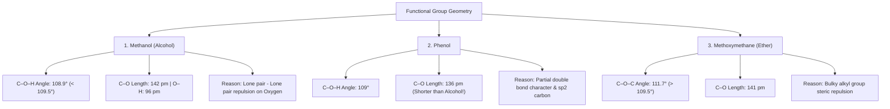

# 🧪 NCERT Class 12 Chemistry (Part II) — Unit 7: Alcohols, Phenols and Ethers
## Comprehensive Study Notes & Fill-in-the-Blanks Question Bank (Pages 3 to 6 / Text Pages 195–198)
### 📘 Author: Er. Manoj Kumar | Nextsem Academy

---

# 📌 1. Comprehensive Notes from Pages 3, 4, 5 & 6

---

### 🔬 1.1 Classification of Ethers & Vinylic Alcohols (Page 3 / Text Page 195)

#### A. Vinylic Alcohols:
- The –OH group is bonded directly to a carbon-carbon double bond, i.e., to an **$sp^2$-hybridised vinylic carbon**.
- *Example:* Vinyl alcohol ($\text{CH}_2=\text{CH}—\text{OH}$).

#### B. Classification of Ethers:
- **1. Symmetrical (Simple) Ethers:**
  - The two alkyl or aryl groups attached to the central oxygen atom are **identical** ($R—O—R$ or $Ar—O—Ar$).
  - *Examples:*
    - Diethyl ether: $\text{C}_2\text{H}_5—\text{O}—\text{C}_2\text{H}_5$
    - Dimethyl ether: $\text{CH}_3—\text{O}—\text{CH}_3$
- **2. Unsymmetrical (Mixed) Ethers:**
  - The two alkyl/aryl groups attached to the oxygen atom are **different** ($R—O—R'$ or $Ar—O—R$).
  - *Examples:*
    - Ethyl methyl ether: $\text{C}_2\text{H}_5—\text{O}—\text{CH}_3$
    - Ethyl phenyl ether (Phenetole): $\text{C}_2\text{H}_5—\text{O}—\text{C}_6\text{H}_5$
    - Methyl phenyl ether (Anisole): $\text{CH}_3—\text{O}—\text{C}_6\text{H}_5$

---

### 🔬 1.2 Nomenclature of Alcohols (Page 4 / Text Page 196)

#### Rules:
1. **Common Names:** Name of the alkyl group + the word **"alcohol"** (e.g., Methyl alcohol).
2. **IUPAC System:**
   - Identify the longest continuous carbon chain containing the –OH group.
   - Replace the terminal **‘e’** of the parent alkane name with the suffix **‘-ol’** (Alkane $\rightarrow$ Alkanol).
   - Number the carbon chain from the end **nearest to the –OH group**.
   - Indicate positions of substituents and –OH with lowest numerical locants.
3. **Polyhydric Alcohols:**
   - Retain the terminal **‘e’** of the alkane name and append **‘-diol’**, **‘-triol’**, etc., with numerical locants.
   - *Example:* $\text{HO}—\text{CH}_2—\text{CH}_2—\text{OH}$ is **Ethane-1,2-diol** (Ethylene glycol).
4. **Cyclic Alcohols:**
   - Use the prefix **cyclo-** with the carbon bearing the –OH assigned as **C-1** (e.g., Cyclohexanol, 2-Methylcyclopentanol).

#### 📋 Table 1: Common & IUPAC Names of Important Alcohols

| Chemical Formula | Common Name | IUPAC Name | Class |
| :--- | :--- | :--- | :---: |
| $\text{CH}_3—\text{OH}$ | Methyl alcohol | **Methanol** | Primary ($1^\circ$) |
| $\text{CH}_3—\text{CH}_2—\text{CH}_2—\text{OH}$ | n-Propyl alcohol | **Propan-1-ol** | Primary ($1^\circ$) |
| $\text{CH}_3—\text{CH(OH)}—\text{CH}_3$ | Isopropyl alcohol | **Propan-2-ol** | Secondary ($2^\circ$) |
| $\text{CH}_3—\text{CH}_2—\text{CH}_2—\text{CH}_2—\text{OH}$ | n-Butyl alcohol | **Butan-1-ol** | Primary ($1^\circ$) |
| $\text{CH}_3—\text{CH}_2—\text{CH(OH)}—\text{CH}_3$ | sec-Butyl alcohol | **Butan-2-ol** | Secondary ($2^\circ$) |
| $(\text{CH}_3)_2\text{CH}—\text{CH}_2—\text{OH}$ | Isobutyl alcohol | **2-Methylpropan-1-ol** | Primary ($1^\circ$) |
| $(\text{CH}_3)_3\text{C}—\text{OH}$ | tert-Butyl alcohol | **2-Methylpropan-2-ol** | Tertiary ($3^\circ$) |
| $\text{HO}—\text{CH}_2—\text{CH}_2—\text{OH}$ | Ethylene glycol | **Ethane-1,2-diol** | Dihydric |
| $\text{CH}_2\text{OH}—\text{CHOH}—\text{CH}_2\text{OH}$ | Glycerol | **Propane-1,2,3-triol** | Trihydric |

---

### 🔬 1.3 Nomenclature of Phenols (Pages 4 & 5 / Text Pages 196–197)

1. **Phenol ($\text{C}_6\text{H}_5\text{OH}$):** Simplest hydroxy derivative of benzene. "Phenol" is both its common name and accepted IUPAC name.
2. **Positional Prefixes in Common vs IUPAC:**
   - **ortho- (o-):** 1,2-disubstituted
   - **meta- (m-):** 1,3-disubstituted
   - **para- (p-):** 1,4-disubstituted

#### 📋 Table 2: Substituted Phenols & Benzenediols

| Structure / Formula | Common Name | IUPAC Name |
| :--- | :--- | :--- |
| $\text{C}_6\text{H}_4(\text{OH})(\text{CH}_3)$ [1,2-] | **o-Cresol** | **2-Methylphenol** |
| $\text{C}_6\text{H}_4(\text{OH})(\text{CH}_3)$ [1,3-] | **m-Cresol** | **3-Methylphenol** |
| $\text{C}_6\text{H}_4(\text{OH})(\text{CH}_3)$ [1,4-] | **p-Cresol** | **4-Methylphenol** |
| $\text{C}_6\text{H}_4(\text{OH})_2$ [1,2-] | **Catechol** | **Benzene-1,2-diol** |
| $\text{C}_6\text{H}_4(\text{OH})_2$ [1,3-] | **Resorcinol** | **Benzene-1,3-diol** |
| $\text{C}_6\text{H}_4(\text{OH})_2$ [1,4-] | **Hydroquinone / Quinol** | **Benzene-1,4-diol** |

---

### 🔬 1.4 Nomenclature of Ethers (Pages 5 & 6 / Text Pages 197–198)

1. **Common Names:** Alkyl/aryl groups listed in **alphabetical order** + the word **"ether"**. If groups are identical, prefix **"di-"** is used.
2. **IUPAC System:** Named as **Alkoxyalkanes**.
   - The **larger** alkyl/aryl group is chosen as the **parent hydrocarbon**.
   - The smaller group with oxygen is treated as an **alkoxy substituent** (e.g., methoxy-, ethoxy-).

#### 📋 Table 3: Ethers Common & IUPAC Names

| Formula | Common Name | IUPAC Name | Type |
| :--- | :--- | :--- | :---: |
| $\text{CH}_3—\text{O}—\text{CH}_3$ | Dimethyl ether | **Methoxymethane** | Symmetrical |
| $\text{C}_2\text{H}_5—\text{O}—\text{C}_2\text{H}_5$ | Diethyl ether | **Ethoxyethane** | Symmetrical |
| $\text{CH}_3—\text{O}—\text{CH}_2\text{CH}_2\text{CH}_3$ | Methyl n-propyl ether | **1-Methoxypropane** | Unsymmetrical |
| $\text{C}_6\text{H}_5—\text{O}—\text{CH}_3$ | Methyl phenyl ether (Anisole) | **Methoxybenzene (Anisole)** | Unsymmetrical |
| $\text{C}_6\text{H}_5—\text{O}—\text{CH}_2\text{CH}_3$ | Ethyl phenyl ether (Phenetole) | **Ethoxybenzene** | Unsymmetrical |
| $\text{C}_6\text{H}_5—\text{O}—(\text{CH}_2)_6\text{CH}_3$ | Heptyl phenyl ether | **1-Phenoxyheptane** | Unsymmetrical |
| $(\text{CH}_3)_2\text{CH}—\text{O}—\text{CH}_3$ | Methyl isopropyl ether | **2-Methoxypropane** | Unsymmetrical |
| $\text{CH}_3—\text{O}—\text{CH}_2\text{CH}_2—\text{O}—\text{CH}_3$ | — | **1,2-Dimethoxyethane** | Symmetrical diether |

---

### 🔬 1.5 Structures of Functional Groups (Pages 6 & 7 / Text Pages 198–199)

#### Detailed Comparative Structural Analysis:

| Parameter | Methanol ($\text{CH}_3\text{OH}$) | Phenol ($\text{C}_6\text{H}_5\text{OH}$) | Methoxymethane ($\text{CH}_3\text{OCH}_3$) |
| :--- | :---: | :---: | :---: |
| **Hybridisation of Carbon** | $\mathbf{sp^3}$ | $\mathbf{sp^2}$ | $\mathbf{sp^3}$ |
| **Hybridisation of Oxygen** | $sp^3$ | $sp^3$ | $sp^3$ |
| **$\text{C}—\text{O}$ Bond Length** | **142 pm** | **136 pm** | **141 pm** |
| **$\text{O}—\text{H}$ Bond Length** | **96 pm** | **96 pm** | — |
| **$\text{C}—\text{O}—\text{H} / \text{C}—\text{O}—\text{C}$ Angle** | **$108.9^\circ$** | **$109^\circ$** | **$111.7^\circ$** |

#### Crucial Conceptual Explanations:
1. **Why is the $\text{C}—\text{O}$ bond in phenol (136 pm) shorter than in methanol (142 pm)?**
   - **(i) Resonance / Partial Double Bond Character:** The unshared lone pair of electrons on oxygen is conjugated with the $\pi$-electron system of the aromatic benzene ring, imparting partial double bond character to the $\text{C}—\text{O}$ bond.
   - **(ii) Hybridisation State:** In phenol, oxygen is bonded to an $sp^2$-hybridised carbon which has greater s-character (33.3%) and is more electronegative, drawing bonding electrons closer than the $sp^3$ carbon (25% s-character) in methanol.
2. **Why is the bond angle in alcohols ($108.9^\circ$) less than the tetrahedral angle ($109.5^\circ$)?**
   - Due to the **repulsion between the two unshared lone electron pairs on the oxygen atom**, which compresses the $\text{C}—\text{O}—\text{H}$ bond angle.
3. **Why is the bond angle in ethers ($111.7^\circ$) greater than the tetrahedral angle ($109.5^\circ$)?**
   - Due to the **steric repulsive interaction between the two bulky alkyl (–R) groups** attached to the oxygen atom.

---

# 📝 2. 25 Master Fill-in-the-Blanks Questions (Pages 3 to 6)

1. Ethers are classified as **`symmetrical`** if both alkyl or aryl groups attached to the oxygen atom are the same.
2. Diethyl ether ($\text{C}_2\text{H}_5\text{OC}_2\text{H}_5$) is a **`symmetrical`** ether, whereas ethyl methyl ether ($\text{C}_2\text{H}_5\text{OCH}_3$) is an **`unsymmetrical`** ether.
3. In vinylic alcohols, the –OH group is attached directly to an **`sp2`**-hybridised vinylic carbon atom of a double bond.
4. According to the IUPAC system, the name of an alcohol is derived by substituting the terminal **`e`** of the parent alkane with the suffix **`ol`**.
5. When naming polyhydric alcohols in IUPAC nomenclature, the **`e`** of the parent alkane is retained before adding '-diol' or '-triol'.
6. The IUPAC name of ethylene glycol ($\text{HO}—\text{CH}_2—\text{CH}_2—\text{OH}$) is **`ethane-1,2-diol`**.
7. The IUPAC name of glycerol is **`propane-1,2,3-triol`**.
8. Isopropyl alcohol has the IUPAC name **`propan-2-ol`**.
9. The IUPAC name of tert-butyl alcohol [$(\text{CH}_3)_3\text{COH}$] is **`2-methylpropan-2-ol`**.
10. In cyclic alcohols, the ring carbon to which the –OH group is attached is always assigned position number **`1`**.
11. The common and accepted IUPAC name for the simplest monohydroxy derivative of benzene is **`phenol`**.
12. The IUPAC name of o-cresol is **`2-methylphenol`**.
13. The IUPAC name of p-cresol is **`4-methylphenol`**.
14. Benzene-1,2-diol is commonly known as **`catechol`**.
15. Benzene-1,3-diol is commonly known as **`resorcinol`**.
16. Benzene-1,4-diol is commonly known as **`hydroquinone`** (or quinol).
17. Common names of ethers are written by listing the alkyl/aryl groups in **`alphabetical`** order followed by the word 'ether'.
18. In the IUPAC system, ethers are named as **`alkoxyalkanes`**.
19. The IUPAC name of anisole ($\text{C}_6\text{H}_5\text{OCH}_3$) is **`methoxybenzene`**.
20. The IUPAC name of phenetole ($\text{C}_6\text{H}_5\text{OCH}_2\text{CH}_3$) is **`ethoxybenzene`**.
21. In alcohols, the oxygen atom is attached to carbon by a **`sigma`** ($\sigma$) bond formed by the overlap of $sp^3$ orbitals.
22. The $\text{C}—\text{O}—\text{H}$ bond angle in methanol is **`108.9`** degrees, which is slightly less than the tetrahedral angle ($109.5^\circ$).
23. The $\text{C}—\text{O}$ bond length in phenol is **`136`** pm, which is shorter than that in methanol (**`142`** pm).
24. The shorter $\text{C}—\text{O}$ bond in phenol is due to **`partial double bond character`** and the **`sp2`** hybridised state of carbon.
25. The $\text{C}—\text{O}—\text{C}$ bond angle in methoxymethane is **`111.7`** degrees, which is greater than the tetrahedral angle due to **`repulsion between bulky alkyl groups`**.

---
