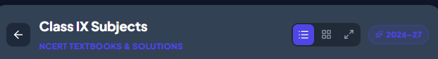
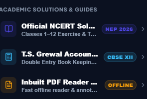
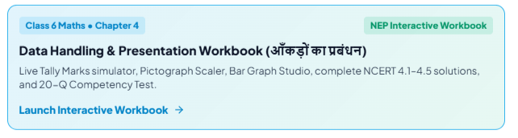
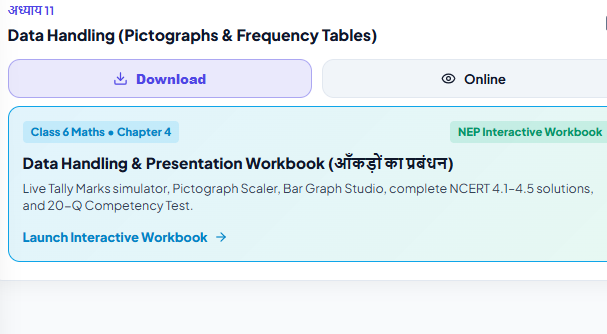

add an option to update the app if new update is made on playstore to those phones where the old app is installed.
always adapt as per users device theme and offer them option to change theme like light, dark and system default.
also i will provide you list of all books pdfs and other pdf files which i want to include in the app, then you have to use your logic to add them in the app in best possible way.
also we can decide how to display them in user friendly way, i have some ideas but i want you to add more ideas to it, we will decide the best way to display them.

as app opens directly show the https://ncert-alpha.vercel.app/?view=classes and after selecting a class take user to select cubject after subject selection take user to list of all chapters each chapter with chapter must have its name download and online notes option, there should be option to bookmark each chapter and access all bookmarked chapters from a single place.

place nios inside left side hamburger icon and when users selects it then do not show ncert i mean switch between nios and ncert. and for nios also show list of all subjects after selecting subject show list of all chapters and for each chapter show download and online notes option. with bookmark option for each chapter.
and nios should have same number of classes as ncert. i.e. 1 to 12 classes. and for each class nios should have subjects accordingly.

add this  eherever there is a list of books.

remove 

update front page to https://nextsem-ncert-2403.web.app/?view=classes also add classes in ascending order

update class-1 subjects thumbnails name from https://ncert.nic.in/textbook.php?aemr1=0-9 also add lessons too 

update class-2 subjects thumbnails name from
https://ncert.nic.in/textbook.php?bejm1=0-11 also add lessons too
update class-3 subjects thumbnails name from
https://ncert.nic.in/textbook.php?cemm1=0-14 also add lessons too
do same for class 4 https://ncert.nic.in/textbook.php?demm1=0-14

for class 5 https://ncert.nic.in/textbook.php?eemm1=0-15

put this under class 6 
 and removde from  http://localhost:3002/?class=2&subject=c2-maths&book=part-1 

for classes 1 to 5 after selecting a subject directly show all chapters

book thumbnails are missing on class 5 4 3
also /learn whever i give you a pdf from public\pdf to make notes or mcq after completing the task put the notes or mcq under that pdf but never put it in a sperate place as it confuses students.

one important thing use let us change the layout of each chpter in class 1 just after selecting a subject like on this page https://ncert-alpha.vercel.app/?class=1&subject=c1-english show all units name with bookmark (add an animation inside the bookmark ) also add below that download (with icon) online(with icon) and worksheet (with icon) for each unit

