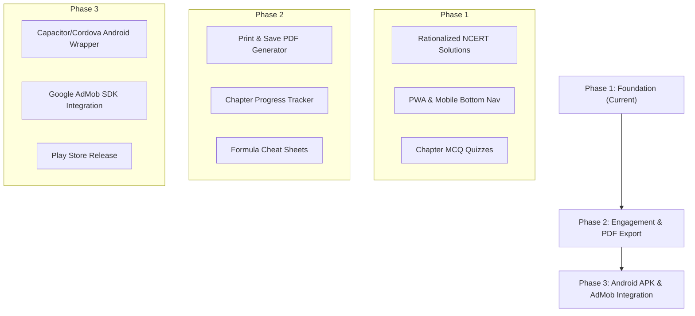

# 💡 Nextsem NCERT - Feature Ideas & Growth Roadmap (`ideas.md`)

> **Mission**: To create India's most student-friendly, fast, and comprehensive **NCERT Learning & Exam Prep Application** for Classes 1 to 12, aligned with **NEP 2020 & NCF**, optimized for mobile web and native Android app deployment with Google AdMob monetization.

---

## 💬 User Original Inputs & Notes (Verbatim)

```text
make ideas.md
```

```text
remove win cmd as it will be solely for ncert
```

```text
make it responsive as it will be used as a website mobile friendly as pwa app and as an android app
```

```text
this will be totally based for android app with admobs integration.
```

```text
 keep logo same as this image with text as NCERT books and solutions by nextsem
```

```text
also use this domain for web app https://ncert.nextsem.online/ as it is our own website. we will work hard to make it number 1 website for NCERT books and solutions.
do not delete my prompts from this file.
```

```text
keep format similiar to this 
```

```text
Redesign this with theme matching to logo 
```

```text
redesign logo for app and website. keep same theme 
```

```text
no logo is not right remake logo with green black and white colours for both light and dark background put NCERT below the logo
```

```text
now add all subjects under CLass 12 when clicked.
```

```text
it should open in new tab not in that page itself.
```

```text
no not this i was saying when i click any class its all subjects should open in a new tab with all subjects
```

```text
i have a doubt if i place above project on ncert.nextsem.online will it disturb nextsem.online sites content or anything.
```

```text
ok then update current project on https://ncert.nextsem.online/
```

```text
for domain name i am using hostinger and for hostnig i am using firebase
```

```text
main task go to https://ncert.nic.in/textbook.php and add all subjects and books with links pointing its actual address and if https://ncert.nic.in/textbook.php is down make a place for loading pdf from our app.
```

```text
this will be a large task let us start with class 12 math only.
```

```text

```

```text
let us redesign the app only no website
```

```text
first view of app after installing should be like 
```

```text
make hamburger menu items similiar to this bit not exactly smae 
```

```text
second page of app must be similiar to thi 
```

```text
after that an ad like this 
```

```text
3rd page like this 
```

```text
4th page like this 
```

```text
an ad like this  and this 
```

```text
6th page like this 
```

```text
REMOVE THIS AND PUT THEME TOGGLE IN HAMBURGER MENU
```

```text
also remove    
```

```text
remoe this too and do not deploy now
```

```text
remove this
```

```text
remove
```

```text
important theme and logo update  use this image for theme reference do not copy exact also make logo similar to this. it should be simple and unique. its name is Nextsem NCERT books and solutions

```text
no for ncert i will use https://ncert-alpha.vercel.app/ and https://nextsem-ncert-2403.web.app/ urls not ncert.nextsem.online
```
```

```text
for now we are going to provide only textbooks and not solutions
```

```text
why offline is not working
```

```text
remove this
```

```text
make a dedicated pages for these links
```

```text
ok let us work only on class 12
```

```text
use actual ncert book front page images instead of random icons for books
```

```text
no no use https://ncert.nic.in/textbook.php?lemh1=0-6 to get actual images of book
```

```text
let me provide images for you
[User provided: Math Part I cover, Math Part II cover, Physics Part I cover, Physics Part II cover, Accountancy Part I cover, Accountancy Part II cover, Accountancy Part III (Computerised Accounting) cover]
```

```text
update
```

```text
do update maths books too
```

```text
why offline not working
```

```text
sorry online not working
```

```text
do not use iframe just open pdf in new tab instead when user clicks on online
```

```text
ok now check weather part 1 maths 12th class is working and right or not
```

```text
clicking offline shows this correct it
```

```text
replace this with offline pdf
```

```text
clicking offline saved must open downloaded pdf and remove this rubbish
```

```text
i find clicking on offline opens online file as in the url i want it to be opened without internet
```

```text
add an option to see bookmarked subjects and chapters here also add functionality to subjects and chapters pages
```

```text
m chahta hu ki agar user dwonload pe click kare to pdf uske mobile m save ho jaye par access sirf app se ho iliye hidden rakhna but app me visible ho aur offline saved pe click krne se download chapter app m hi open ho jaye
```

```text
m chahta hu ki agar user dwonload pe click kare to pdf uske mobile m save ho jaye par access sirf app se ho iliye hidden rakhna but app me visible ho aur offline saved pe click krne se download chapter app m hi open ho jaye par abhi dowload pe click krne se ye aa ra hai
```

```text
abhi bhi ye hai
```

```text
deploy kardo prod
```

```text
offline files ka ek option bna do jha pe saare offline pdf open ho
```

```text
aur yrr localstorage ka kuch karo tum to offline file k loye bhi online ncert ki site use kar rahe ho
```

```text
fir yahi error yrr kya hai ye
```

```text
ncert.nic.in refused to connect iframe issue on mobile
```

```text
isme pdf k lnk galat hai thik karo
```

```text
https://ncert.nic.in/pdf/publication/exemplarproblem/classXII/mathematics/leep201.pdf
```

```text
back functionality shi karo back press krne pe mobile m prev window open ho aur last 20 locations yaad rakho
```

```text
iske links shi karo m ek reference link de ra hu https://ncert.nic.in/textbook.php?leph1=1-8
```

```text
https://ncert.nic.in/textbook.php?leph2=1-6 ise bhi
```

```text
https://ncert.nic.in/pdf/publication/exemplarproblem/classXII/physics/leep101.pdf ise bhi kardo
```

```text
subjects pe bhi bookmark option add kardo
```

```text
https://ncert.nic.in/pdf/publication/exemplarproblem/classXII/physics/leep101.pdf is link se update karo abhi galat links hai
```

```text
https://ncert.nic.in/pdf/publication/exemplarproblem/classXII/chemistry/leep501.pdf
```

```text
https://ncert.nic.in/pdf/publication/exemplarproblem/classXII/biology/leep401.pdf
```

```text
ye hta do esi koi book nhi hai
```

```text
https://ncert.nic.in/textbook.php?lecs1=1-13 ye update karo
```

```text
ye image update karo
```

```text
nhi exact yhi image use karo gemini se nhi banwao
```

```text
aur url bhi class subject chapter k hisab se update karo refresh krte hi sab gayab ho ja ra hai
```

```text
ok nice
```

```text
inpe click krne pe admobs ka actual ad open ho esa karo
```

```text
ok ab ek important task isme kahi pe solutions ka options bhi add karo
```

```text
aur solutions pe click krne pe pdf open ho aur google lens automatically open ho pdf k upar taki user jo select kare uska answer gemini se usi time pe search karke wahi pe dikhao aur ad bhi implement karo
```

```text
mujhe esa nhi pdf open ho aur lens moveable form m uske upar ho aur select krne pe automation uska explanation aa jaye gemini use karke
```

```text
remove these as we will make solutions page somewhere else
```

```text
ad here a NEW NCERT solutions page
```

```text
these links ar to be completed just show ork in progress for these
```

```text
how muxch work is done under
```

```text
remove it
```

```text
use this image and this link as reference for units https://ncert.nic.in/textbook.php?levt1=1-6
```

```text
https://ncert.nic.in/textbook.php?lekl1=1-21 under enfglosh 12th
```

```text
remove from everythwhere
```

```text
i want to make our apps first page to be just a selection from NCERT Books NCERT notes NIOS Books NIOS notes each their own image each having the corrosponding text
```

```text
also use colour as per your choice but do not use neo coour
```

```text
i want front page to be similiat to this make promt for this
```

```text
this will be second screen write deatiled prompt for ti
```

```text
https://drive.google.com/file/d/17p40by94dEPEZ24P6bFGr_J-uK2H0B1n/view make mcq from this pdf but of difficult level
```

```text
npm build and run and give me link
```

```text
shuffle the options
```

```text
make questions numerical type for each type from this pdf
```

```text
let us read and make numericals on cash book
```

```text
show hints in each step
```

```text
show in t shape format
```

```text
https://drive.google.com/file/d/1UlZsH3Q4MA3u2j2BMh6ysaAxEhxAVVq7/view?usp=drive_open explain line by line and ask mcq after every 5 line do it quickly
```

```text
close this file and update on git
```

```text
also deploy to prod
```

---

## 🎯 1. Mobile & Android App Innovations

### 1.1 **Offline Solution Caching (PWA & Room DB)**
- **Feature**: Allow students to save entire chapters for offline viewing without internet access.
- **Benefit**: Essential for students living in areas with poor network connectivity.
- **Implementation**: Service Worker caching on Web/PWA and Android Room SQLite database for native APK.

### 1.2 **Audio Explanation (Text-to-Speech)**
- **Feature**: Add a "🔊 Listen to Solution" button powered by Web Speech API (`speechSynthesis`).
- **Benefit**: Aids auditory learners, visually impaired students, and younger primary students (Classes 1–5).

### 1.3 **Downloadable Solution PDFs with Rewarded Ads**
- **Feature**: Provide high-resolution printable NCERT solution PDFs for each chapter.
- **Monetization**: Students watch a 15-second AdMob Rewarded Video Ad to instantly unlock free PDF downloads.

---

## 🧠 2. Academic & Pedagogical Features (NEP 2020 Aligned)

### 2.1 **Competency-Based Questions (CBQs) Hub**
- **Feature**: Dedicated tab for Case Study Questions, Assertion-Reasoning Problems, and Real-Life Application scenarios as mandated by CBSE Board 2025-2026.
- **Goal**: Help students move away from rote learning toward conceptual mastery.

### 2.2 **Formula & Concept Cheat Sheets**
- **Feature**: Quick-access "Formula Hub" tab per subject (Maths, Physics, Chemistry) listing all crucial equations, SI units, and theorems in one place.

### 2.3 **Previous Year Question (PYQ) Tags**
- **Feature**: Tag exercise solutions with historical board exam frequency (e.g., `CBSE 2024 (3 Marks)`, `CBSE 2023`, `NCERT Exemplar`).
- **Benefit**: Allows students to prioritize high-weightage questions during revision.

---

## 🎮 3. Gamification & Student Engagement

### 3.1 **Daily Study Streaks & Badges**
- **Feature**: Track consecutive days spent solving practice quizzes and reading NCERT solutions.
- **Rewards**: Unlock virtual badges like *"Math Genius"*, *"Physics Wizard"*, *"7-Day Streak Holder"*.

### 3.2 **Interactive Chapter MCQ Quiz Engine**
- **Feature**: 10-question timed practice quizzes per chapter with instant score breakdown, explanation notes, and celebratory confetti animations.

### 3.3 **Progress Tracker Dashboard**
- **Feature**: Visual progress bars showing percentage of exercise solutions completed per subject.

---

## 💰 4. AdMob Monetization Strategy

1. **Adaptive Bottom Banner Ads**: Displayed at the bottom of solution reader screens without covering mathematical formulas.
2. **Smooth Interstitial Ads**: Triggered when moving between major chapter transitions (frequency capped to max 1 ad per 5 minutes).
3. **Rewarded Video Ads**: Voluntary video views to unlock printable PDFs, premium practice tests, or ad-free 1-hour study passes.

---

## 🗺️ 5. Phased Implementation Roadmap



---

## 📌 Document Metadata
- **Project**: Nextsem NCERT Solutions & Learning App
- **Target Platform**: Responsive Web, PWA, Android App (Google Play Store)
- **Framework**: React 19 + TypeScript + Vite + CSS Variables

 keep logo same as this image with text as NCERT books and solutions by nextsem

also use this domain for web app https://ncert.nextsem.online/ as it is our own website. we will work hard to make it number 1 website for NCERT books and solutions.
do not delete my prompts from this file.

keep format similiar to this 

remove this 

Redesign this with theme matching to logo 

redesign logo for app and website. keep same theme 

no logo is not right remake logo with green black and white colours for both light and dark background put NCERT below the logo

now add all subjects under CLass 12 when clicked.

it should open in new tab not in that page itself.

no not this i was saying when i click any class its all subjects should open in a new tab with all subjects

i have a doubt if i place above project on ncert.nextsem.online will it disturb nextsem.online sites content or anything.

ok then update current project on https://ncert.nextsem.online/
for domain name i am using hostinger and for hostnig i am using firebase

main task go to https://ncert.nic.in/textbook.php and add all subjects and books with links pointing its actual address and if https://ncert.nic.in/textbook.php is down make a place for loading pdf from our app.


this will be a large task let us start with class 12 math only.


let us redesign the app only no website

first view of app after installing should be like 

make hamburger menu items similiar to this bit not exactly smae 

second page of app must be similiar to thi 
after that an ad like this 
3rd page like this 
```
4th page like this 

5th like 

an ad like this  and this 


REMOVE THIS AND PUT THEME TOGGLE IN HAMBURGER MENU

also remove    

important theme and logo update  use this image for theme reference do not copy exact also make logo similar to this. it should be simple and unique. its name is Nextsem NCERT books and solutions
 
i want to make our apps first page to be just a selection from NCERT Books NCERT notes NIOS Books NIOS notes each their own image each having the corrosponding text
 
also use colour as per your choice but do not use neo coour
 
i want front page to be similiat to this make promt for this
 
this will be second screen write deatiled prompt for ti
 
https://drive.google.com/file/d/17p40by94dEPEZ24P6bFGr_J-uK2H0B1n/view make mcq from this pdf but of difficult level

i want front page to be similiat to this make promt for this
 
this will be second screen write deatiled prompt for ti
 
https://drive.google.com/file/d/17p40by94dEPEZ24P6bFGr_J-uK2H0B1n/view make mcq from this pdf but of difficult level
 
npm build and run and give me link
 
shuffle the options
 
make questions numerical type for each type from this pdf
 
let us read and make numericals on cash book
 
show hints in each step
 
show in t shape format

https://drive.google.com/file/d/1UlZsH3Q4MA3u2j2BMh6ysaAxEhxAVVq7/view?usp=drive_open explain line by line and ask mcq after every 5 line do it quickly

close this file and update on git

also deploy to prod
